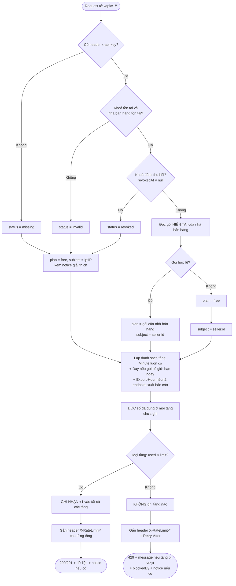

# Bài 7 – Hệ thống hạn mức phân tầng theo gói dịch vụ

| Gói | Mỗi phút | Mỗi ngày | Xuất báo cáo |
|---|---|---|---|
| Free | 60 | 5.000 | 10 / giờ |
| Pro | 600 | 200.000 | 10 / giờ |
| Enterprise | 6.000 | không giới hạn | 10 / giờ |
| *Không có khoá / khoá sai / khoá bị thu hồi* | *60 (như Free)* | *5.000* | *10 / giờ* |

```
src/
├── quota/
│   ├── plans.ts                      # chính sách kinh doanh → con số kỹ thuật (nguồn duy nhất)
│   ├── quota.service.ts              # bộ máy quyết định nhiều tầng, "tất cả hoặc không"
│   ├── quota.guard.ts                # điều phối các bước, header phản hồi, body 429
│   └── windows/                      # 3 thuật toán đếm cho 3 tầng
│       ├── sliding-window-counter.ts #   tầng phút
│       ├── fixed-window-counter.ts   #   tầng ngày (reset 00:00 giờ VN)
│       └── sliding-log.ts            #   tầng xuất báo cáo
├── identity/
│   ├── identity.service.ts           # API key → nhà bán hàng → gói; bẫy khoá thiếu/thu hồi
│   └── seller.store.ts               # dữ liệu nhà bán hàng + khoá (thay cho database)
├── api/
│   ├── seller-api.controller.ts      # GET /api/v1/products, POST /api/v1/reports/export
│   └── admin.controller.ts           # đổi gói, thu hồi khoá, reset dữ liệu demo
└── clock.service.ts                  # đồng hồ thật / giả lập để demo
```

---

# Phần A – Phân tích và thiết kế

## A1. Phân tích bài toán (I/O)

### Đầu vào cần có để ra quyết định

| Dữ liệu | Lấy từ đâu | Kiểu | Ghi chú |
|---|---|---|---|
| `apiKey` | header `x-api-key` | `string \| undefined` | Có thể thiếu, sai, hoặc đã bị thu hồi |
| `ip` | kết nối TCP (`req.ip`) | `string` | Chỉ dùng làm định danh khi không có khoá hợp lệ |
| `endpoint` | route đang gọi (metadata `@UseEndpointQuota`) | `'report-export' \| undefined` | Xác định có áp hạn mức riêng hay không |
| `now` | đồng hồ máy chủ | `number` (ms, epoch) | Không bao giờ lấy từ client trên production |
| `apiKey.sellerId` | kho khoá | `string` | Một nhà bán hàng có thể có nhiều khoá |
| `apiKey.revokedAt` | kho khoá | `string (ISO-8601) \| null` | Khác `null` nghĩa là khoá đã bị thu hồi |
| `seller.plan` | kho nhà bán hàng, **đọc lại mỗi request** | `'free' \| 'pro' \| 'enterprise'` (dữ liệu thô là `string`) | Giá trị lạ thì về gói thấp nhất |
| Bộ đếm từng tầng | kho bộ đếm | `{windowStart, prev, curr}` / `{windowStart, count}` / `number[]` | Xem A2 |

### Đầu ra – nhánh **cho qua** (`200` / `201`)

Body của endpoint, kèm `notice` nếu đang bị hạ xuống hạn mức thấp nhất. Các header:

| Header | Kiểu | Ví dụ | Ý nghĩa |
|---|---|---|---|
| `X-RateLimit-Plan` | string | `free` | Gói **đang được áp dụng**, không phải gói đã mua |
| `X-ApiKey-Status` | `active \| missing \| invalid \| revoked` | `active` | Trạng thái khoá |
| `X-RateLimit-Limit-{Tầng}` | int | `60` | Hạn mức của tầng: `Minute`, `Day`, `Export-Hour` |
| `X-RateLimit-Remaining-{Tầng}` | int | `59` | Số lượt còn lại, đã tính cả request này |
| `X-RateLimit-Reset-{Tầng}` | int (giây) | `20` | Còn bao lâu thì cửa sổ của tầng làm mới |
| `X-RateLimit-Limit` / `-Remaining` / `-Reset` | int | `60` / `59` / `20` | Bản tóm tắt: lấy tầng **chặt nhất** (còn ít lượt nhất) |

Gói Enterprise **không có** header tầng `Day`. Header tầng `Export-Hour` chỉ xuất hiện trên endpoint xuất báo cáo.

### Đầu ra – nhánh **chặn** (`429 Too Many Requests`)

Vẫn đủ các header như trên, thêm `Retry-After` (số giây phải chờ để **mọi** tầng đang bị vượt đều mở lại). Body:

```json
{
  "statusCode": 429,
  "error": "Too Many Requests",
  "message": "Đã vượt hạn mức 60 request/phút của gói Free. Thử lại sau 21 giây.",
  "plan": "free",
  "planName": "Free",
  "apiKeyStatus": "revoked",
  "blockedBy": [{ "tier": "Minute", "limit": 60, "retryAfterSeconds": 21 }],
  "notice": "API key đã bị thu hồi lúc 2026-10-01T00:00:00.000Z. Hệ thống áp dụng hạn mức thấp nhất (gói Free), tính theo địa chỉ IP. Hãy tạo khoá mới để dùng lại hạn mức của gói."
}
```

## A2. Đề xuất giải pháp

### Khoá định danh bộ đếm

```
<subject>|<tầng>          ví dụ:  seller:seller-pro|Minute
                                  seller:seller-pro|Day
                                  seller:seller-pro|Export-Hour
                                  ip:203.0.113.7|Minute      ← khi không có khoá hợp lệ
```

- **`subject` là nhà bán hàng, không phải API key.** Một nhà bán hàng có nhiều khoá vẫn dùng chung một hạn mức. Tạo khoá mới cũng không làm hạn mức "hồi sinh".
- **Khoá định danh không chứa tên gói.** Vì vậy khi đổi gói, bộ đếm đang chạy vẫn được giữ nguyên và chỉ có **hạn mức** để so sánh thay đổi. Hạn mức không lưu trong bộ đếm mà được tra theo gói hiện tại ở **mỗi request**. Đây là cách xử lý bẫy nâng cấp giữa chừng.
- **Không có khoá hợp lệ thì `subject = ip:<ip>`, gói = Free.** Lưu lượng từ một khoá đã bị thu hồi không được đếm vào hạn mức của chủ khoá, nên kẻ cầm khoá bị lộ không thể làm cạn hạn mức của nhà bán hàng thật.

### Mỗi tầng dùng thuật toán phù hợp với nó

| Tầng | Thuật toán | Lý do |
|---|---|---|
| Phút | Cửa sổ trượt ước lượng (Bài 6) | Chặn được kiểu dồn request ở mép cửa sổ. Bộ nhớ O(1) mỗi khoá dù hạn mức lớn tới 6.000/phút |
| Ngày | Cửa sổ cố định theo lịch, reset 00:00 giờ VN | Hạn mức ngày là hạn mức gói cước: nhà bán hàng cần một mốc reset dễ hiểu, dễ đối soát. Việc chống dồn request từng giây đã do tầng phút đảm nhận |
| Xuất báo cáo | Nhật ký trượt (lưu mốc thời gian) | Tài nguyên đắt tiền cần chặn **chính xác tuyệt đối** ở lần thứ 11 trong bất kỳ 60 phút nào. Hạn mức nhỏ nên mỗi khoá chỉ lưu tối đa 10 mốc |

### Xử lý nhiều tầng cùng lúc: "tất cả hoặc không"

1. Lấy danh sách tầng áp dụng: `Minute` luôn có; `Day` nếu gói có giới hạn ngày; `Export-Hour` nếu endpoint đắt tiền.
2. **Đọc** số đã dùng ở mọi tầng, chưa ghi gì.
3. Nếu mọi tầng còn chỗ thì **ghi nhận vào tất cả** và cho qua. Nếu có tầng đã đầy thì **không ghi vào tầng nào** và chặn.

Nhờ vậy, request bị một tầng chặn không ăn vào hạn mức của các tầng khác. Ví dụ, lần xuất báo cáo thứ 11 bị chặn sẽ không trừ một lượt trong hạn mức phút.

### Lưu bộ đếm ở đâu

- **Bản nộp bài:** lưu trong RAM (`Map`), đủ cho một instance.
- **Production nhiều instance:** dùng Redis, khoá như trên kèm TTL bằng độ dài cửa sổ. Bước 2–3 phải gộp thành **một Lua script** để thao tác "đọc mọi tầng → ghi tất cả" là nguyên tử giữa các instance.
- **Gói và trạng thái khoá:** đọc từ database ở mỗi request. Nếu có cache thì phải xoá cache ngay khi đổi gói hoặc thu hồi khoá (publish một sự kiện), nếu không bẫy nâng cấp sẽ quay lại.

## A3. Thiết kế các bước



Các bước tương ứng trong code ([quota.guard.ts](src/quota/quota.guard.ts)):

1. **B1–B2:** `IdentityService.resolve()` xác định danh tính và gói. Đây là các điểm rẽ nhánh về khoá: thiếu / sai / thu hồi / hợp lệ, và gói hỏng / hợp lệ.
2. **B3:** đọc metadata `@UseEndpointQuota` để biết endpoint có hạn mức riêng hay không.
3. **B4–B5:** `QuotaService.consume()` đọc mọi tầng, rồi ghi tất cả hoặc không ghi gì. Đây là điểm rẽ nhánh cho qua / chặn.
4. **B6:** gắn header cho cả hai nhánh. Nếu bị chặn thì ném `429` với body giải thích.

---

# Phần B – Triển khai và chống lỗi

## Đoạn mã chặn từng bẫy dữ liệu

### Bẫy 1 – Nâng cấp gói giữa chừng phải có hiệu lực ngay

[identity.service.ts](src/identity/identity.service.ts) đọc gói mới ở mỗi request:

```ts
// BAY 1: goi doc moi request tu kho (khong cache) -> nang cap giua chung co hieu luc ngay.
const plan = isPlan(seller.plan) ? seller.plan : LOWEST_PLAN;
return { subject: `seller:${seller.id}`, plan, apiKeyStatus: 'active', sellerId: seller.id };
```

[quota.service.ts](src/quota/quota.service.ts) dùng khoá bộ đếm không chứa gói, còn hạn mức được tra theo gói của request hiện tại:

```ts
const key = `${subject}|${rule.name}`;
```

Thông báo cho nhà bán hàng khi đổi gói: `"Đã chuyển sang gói pro, có hiệu lực ngay từ request kế tiếp."`. Request kế tiếp có header `X-RateLimit-Plan: pro` và `X-RateLimit-Limit-Minute: 600`.

### Bẫy 2 – Thiếu khoá hoặc khoá bị thu hồi phải bị chặn ở hạn mức thấp nhất

Trích [identity.service.ts](src/identity/identity.service.ts):

```ts
if (!key) {
  return this.lowest(req, 'missing', `Request không có header x-api-key. ${FALLBACK}`);
}
...
if (apiKey.revokedAt) {
  return this.lowest(req, 'revoked',
    `API key đã bị thu hồi lúc ${apiKey.revokedAt}. ${FALLBACK} Hãy tạo khoá mới để dùng lại hạn mức của gói.`);
}
...
private lowest(req, apiKeyStatus, notice): Identity {
  return { subject: `ip:${req.ip}`, plan: LOWEST_PLAN, apiKeyStatus, notice };
}
```

Thông báo được gửi tới nhà bán hàng qua ba kênh: header `X-ApiKey-Status`, trường `notice` trong body của cả nhánh `200` lẫn `429`, và header `X-RateLimit-Plan: free`.

### Bẫy phát sinh thêm

- **Dữ liệu gói bị hỏng** (ví dụ `plan = "gold"`): hệ thống về gói thấp nhất, không ném lỗi và cũng không vô tình cấp gói cao.
- **Tầng bị chặn ăn hạn mức của tầng khác:** đã xử lý bằng cơ chế "tất cả hoặc không".

## Chạy và kiểm thử

```bash
npm install
npm test                                       # 43 test
npm run start:dev                              # http://localhost:3000, đồng hồ thật
ALLOW_FAKE_CLOCK=true npm run start:dev        # cho phép header x-fake-now (giây) để demo
```

Dữ liệu mẫu:

| API key | Nhà bán hàng | Gói |
|---|---|---|
| `sk_free_demo` | seller-free | free |
| `sk_pro_demo` | seller-pro | pro |
| `sk_ent_demo` | seller-ent | enterprise |
| `sk_upgrade_demo` | seller-upgrade | free (dùng để demo nâng cấp) |
| `sk_ent_revoked` | seller-ent | **đã thu hồi** |

API quản trị (header `x-admin-token: admin-secret`, đổi được bằng biến môi trường `ADMIN_TOKEN`):

| Method | Đường dẫn | Tác dụng |
|---|---|---|
| `GET` | `/admin/sellers` | Xem nhà bán hàng và khoá |
| `PATCH` | `/admin/sellers/:id/plan` (body `{"plan":"pro"}`) | Đổi gói |
| `POST` | `/admin/api-keys/:key/revoke` | Thu hồi khoá |
| `POST` | `/admin/reset` | Khôi phục dữ liệu mẫu, xoá mọi bộ đếm |

Test và tiêu chí chấm:

| Tiêu chí | Test |
|---|---|
| Đủ 4 quy tắc, từng gói | [test/quota.service.spec.ts](test/quota.service.spec.ts): nhóm "Quy tac 1" đến "Quy tac 4". Gồm Free 61/phút và 5.001/ngày, Pro 601/phút và 200.001/ngày, Enterprise 6.001/phút và 300.000 request/giờ không bị chặn theo ngày |
| Xuất báo cáo bị chặn ở lần thứ 11, kể cả Enterprise | `it.each(PLANS)`: lần thứ 11 bị chặn bởi tầng `Export-Hour`, chạy cho cả 3 gói. Thêm test e2e với khoá Enterprise |
| Nâng cấp có hiệu lực ngay | Nhóm "Bay 1": Free→Pro (phút và ngày), Pro→Enterprise, hạ gói. Thêm test e2e qua `PATCH /admin/...` |
| Thiếu khoá / khoá thu hồi về hạn mức thấp nhất | Nhóm "Bay 2" trong [test/api.e2e-spec.ts](test/api.e2e-spec.ts): thiếu khoá, khoá sai, khoá Enterprise đã thu hồi chỉ được 60/phút, thu hồi giữa chừng, lưu lượng từ khoá đã thu hồi không trừ vào hạn mức của chủ khoá |

Bộ test đã được kiểm chứng bằng cách cố ý phá từng quyết định thiết kế:

| Thay đổi cố ý | Số test thất bại |
|---|---|
| Đưa tên gói vào khoá bộ đếm | 4 |
| Ghi nhận cả khi request bị chặn | 5 |
| Bỏ kiểm tra khoá thu hồi | 3 |
| Bỏ kiểm tra dữ liệu gói hỏng | 1 |
