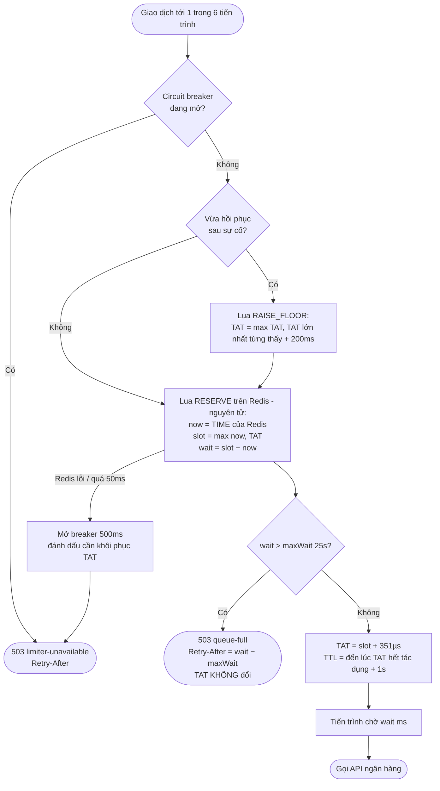

# Bài 8 – Chọn thuật toán giới hạn cho cổng thanh toán

> **Kết luận:** dùng **gáo rò dạng hàng đợi**, cài đặt bằng **GCRA trên Redis**. Thông số: tốc độ **2.850 req/s** (chừa 5% biên an toàn), thời gian **chờ tối đa 25 giây**, cả 6 tiến trình dùng chung **một khoá** thông qua một Lua script nguyên tử. Hệ thống **fail-closed** khi Redis gặp sự cố.
>
> Kết quả trên mô phỏng đúng tải đề bài (390.466 request): **0 lần vượt 3.000 req/s**, **0 giao dịch bị chặn** trong đợt đột biến ×2,5, bộ nhớ **92 byte / khoá**. Cùng điều kiện đó, nhật ký trượt chặn 64.846 giao dịch, gáo token an toàn chặn 67.730, cửa sổ cố định vượt ngưỡng 44.452 lần.

```
src/
├── algorithms/                 # 5 thuật toán, cùng interface Limiter
│   ├── fixed-window.ts         #   (a)
│   ├── sliding-log.ts          #   (b)
│   ├── sliding-window-counter.ts # (c)
│   ├── token-bucket.ts         #   (d)
│   ├── leaky-bucket-queue.ts   #   (e) bản 1 tiến trình
│   └── gcra.ts                 #   ★ lõi của (e): một hàm duy nhất, Lua là bản dịch 1-1
├── distributed/
│   ├── redis-slot-store.ts     # ★ Lua script trên Redis (đồng bộ 6 tiến trình)
│   ├── slot-store.ts           #   interface + bản trong bộ nhớ (cùng ngữ nghĩa, dùng cho test/mô phỏng)
│   └── payment-rate-limiter.ts # ★ chạy trong mỗi tiến trình: xin ô gửi, chờ, fail-closed, khôi phục
└── simulation/                 # mô phỏng tải đề bài + đo bộ nhớ thật
```

---

# A. Phân tích và đề xuất đa giải pháp

## A1. Đầu vào và đầu ra

| | Dữ liệu | Kiểu | Ghi chú |
|---|---|---|---|
| **Vào** | Khoá giới hạn | `string` | `bank:<đối tác>`. **Một khoá dùng chung** cho cả 6 tiến trình, vì ngân hàng đếm **tổng** request của ShopFast |
| | Thời điểm request | `number` (µs) | Lấy theo **đồng hồ Redis** (`TIME`), không lấy theo đồng hồ từng máy, để tránh lệch giờ giữa 6 máy |
| | Tốc độ cho phép `r` | `number` (req/s) | 2.850 = 3.000 × 95% |
| | Thời gian chờ tối đa | `number` (ms) | 25.000 |
| | Trạng thái của khoá | `TAT: int64` (µs) | *Theoretical Arrival Time*: thời điểm sớm nhất mà request **kế tiếp** được gửi |
| **Ra** | Cho qua | `{ waitMs: number }` | Tiến trình chờ `waitMs`, sau đó mới gọi ngân hàng |
| | Chặn | `RateLimitRejectedError { reason, retryAfterMs }` | `queue-full` (hàng đợi đầy) hoặc `limiter-unavailable` (Redis sự cố). Trả cho client `503` kèm `Retry-After` |

## A2. Đặc điểm quan trọng nhất của bài toán

1. **Đây là giới hạn đầu ra cứng do hạ nguồn áp đặt, không phải chuyện chia đều cho người dùng.** Chỉ cần vượt một lần là bị cắt kết nối 15 phút: khoảng 2.000 × 900 = **1,8 triệu giao dịch** không xử lý được. Vì vậy độ chính xác tại biên không phải là "càng tốt càng hay" mà là ràng buộc bắt buộc.
2. **Đợt đột biến vượt chính ngưỡng cứng.** Nhu cầu là 2.000 × 2,5 = **5.000 req/s**, trong khi ngưỡng chỉ có 3.000. Không thuật toán nào "cho phép bùng nổ" giúp được, vì cho bùng nổ tức là vượt ngưỡng. Muốn không chặn giao dịch thì cách duy nhất là **dời chúng sang thời điểm khác** (xếp hàng), tận dụng phần công suất còn dư sau đợt đột biến (3.000 − 2.000 = 1.000 req/s).
3. **Ba con số quyết định thiết kế:**
   - Phần vượt trong đợt đột biến: 150.000 − 2.850 × 30 ≈ **64.500 request**.
   - Request cuối cùng phải chờ khoảng 64.500 / 2.850 ≈ **22,6 giây**. Do đó thời gian chờ tối đa phải lớn hơn mức này.
   - Hàng đợi xả hết sau 64.500 / (2.850 − 2.000) ≈ **76 giây**.

## A3. Năm giải pháp và nguyên lý của chúng

| | Nguyên lý | Trạng thái mỗi khoá |
|---|---|---|
| **(a) Cửa sổ cố định** | Đếm request trong ô `[k·1s, (k+1)·1s)`, sang ô mới thì về 0 | 1 bộ đếm + mốc ô |
| **(b) Nhật ký cửa sổ trượt** | Lưu mốc thời gian của từng request, đếm số mốc nằm trong 1 giây gần nhất | Tối đa `L` mốc thời gian |
| **(c) Bộ đếm cửa sổ trượt** | Ước lượng `curr + prev × phần còn lại của ô trước` (Bài 6) | 2 bộ đếm + mốc ô |
| **(d) Gáo token** | Gáo chứa tối đa `B` token, nạp `r` token/s, mỗi request lấy 1 token. Trong bất kỳ khoảng `T` nào có tối đa `B + r·T` request | Số token + thời điểm nạp |
| **(e) Gáo rò dạng hàng đợi (GCRA)** | Request "rò" ra đều đặn, mỗi ô gửi cách nhau `1/r`. Khi tới sớm thì **chờ tới ô của mình**, chỉ khi phải chờ quá lâu mới bị chặn | **1 số** (`TAT`) |

Ba nhóm này khác nhau thật sự về nguyên lý:
- **(a)(b)(c)** đếm request trong một cửa sổ thời gian.
- **(d)** tích luỹ quyền gửi (token).
- **(e)** lập lịch thời điểm gửi.

Chỉ **(e)** trả lời được câu hỏi *"bao giờ thì được gửi"* thay vì chỉ trả lời *"có hay không"*.

---

# B. So sánh và lựa chọn

## B1. Bảng so sánh

| Tiêu chí | (a) Cửa sổ cố định | (b) Nhật ký trượt | (c) Bộ đếm trượt | (d) Gáo token | (e) Gáo rò / GCRA |
|---|---|---|---|---|---|
| **Độ chính xác tại biên** | ✗ Hai đợt sát mép ô cho lọt tới **2L** trong 1 ms ([test](test/algorithms.spec.ts)) | ✓ Chính xác tuyệt đối | ✗ Chỉ là ước lượng: test cho lọt **3.003** request / 2 ms với L = 3.000 | ✓ Có trần `B + r` cho mọi khoảng 1 giây, **nếu** cấu hình `B + r ≤ L` | ✓ Các ô gửi cách đều 351 µs, nên không bao giờ quá 2.850 / giây |
| **Bộ nhớ cho 100.000 khoá** (đo thật, xem B2) | 12,6 MB | ✗ **2.203 MB**, gấp 8,6 lần 256 MB | 13,4 MB | 14,1 MB | ✓ **8,8 MB** (thấp nhất) |
| **Chịu tăng đột biến ngắn** (×2,5 trong 30 giây) | Chặn khoảng 60.000, và vẫn vượt ngưỡng | Chặn 64.846 | Chặn 64.834 | `B` lớn thì vượt ngưỡng; `B` nhỏ (an toàn) thì chặn 67.730 | ✓ **Xếp hàng**: chặn 0, chờ tối đa 22,8 giây |
| **Độ phức tạp khi chạy phân tán** | Thấp (`INCR` + `EXPIRE`) | ✗ Cao: `ZSET` hàng nghìn phần tử, 3 lệnh mỗi request, O(log n) | Trung bình: 2 bộ đếm, cần Lua | Trung bình: Lua đọc, nạp, ghi 2 trường | ✓ Thấp: Lua `GET` + `SET` **1 số nguyên** |
| **Chặn oan lúc tải thường** | 0 | 0 | 0 | 0 | 0 khi có hàng đợi. Với **chờ = 0** thì chặn oan 32.863 (xem B3) |
| **Cho biết thời gian phải chờ** | ✗ | ✗ | ✗ | ✗ | ✓ `waitMs` |

## B2. Bộ nhớ: phép tính và số đo

Xét trường hợp xấu nhất: mọi khoá đều đang hoạt động ở mức trần `L = 2.850 req/s`.

| | Phép tính dữ liệu thô / khoá | **Đo thật trong Node.js** / khoá¹ | × 100.000 khoá | Redis (ước lượng)² × 100.000 | So với 256 MB |
|---|---|---:|---:|---:|---|
| (a) | 2 số × 8 B = 16 B | 132 B | 12,6 MB | ~11 MB | ✓ |
| (b) | **2.850 mốc × 8 B = 22.800 B** | 23.096 B | **2.203 MB** | ~27 GB (ZSET ~100 B/phần tử) | ✗ **gấp 8,6 lần** |
| (c) | 3 số × 8 B = 24 B | 140 B | 13,4 MB | ~12 MB | ✓ |
| (d) | 2 số × 8 B = 16 B | 148 B | 14,1 MB | ~12 MB | ✓ |
| **(e)** | **1 số × 8 B = 8 B** | **92 B** | **8,8 MB** | **~11 MB** | ✓ **3,4%** |

¹ Đo bằng `npm run bench:memory`: `heapUsed + arrayBuffers` trước và sau, mỗi thuật toán đo trong một tiến trình riêng. Số đo đã gồm phần phụ trội của `Map` và chuỗi khoá `merchant:<id>`.
² Mỗi khoá Redis dạng string có phần phụ trội khoảng 90–110 B (dictEntry, robj, SDS của khoá và giá trị, mục trong bảng TTL).

Với bài toán này, **số khoá thực tế là 1** (`bank:<đối tác>`), nên mọi thuật toán đều nằm gọn trong 256 MB, kể cả nhật ký trượt (khoảng 23 KB). Bẫy 256 MB chỉ lộ ra khi mở rộng sang nhiều khoá, ví dụ thêm giới hạn riêng cho từng nhà bán hàng: lúc đó **chỉ riêng (b) không chạy được**, vì bộ nhớ của nó tỉ lệ với **hạn mức** chứ không chỉ với số khoá.

Phương án chọn còn có một phần bộ nhớ khác: các request đang **chờ trong hàng** nằm ở 6 tiến trình API, không nằm trong tiến trình giới hạn tần suất. Tối đa khoảng 64.500 request × ~2 KB ≈ 130 MB, chia cho 6 tiến trình là khoảng 22 MB mỗi tiến trình, và chỉ tồn tại tối đa 25 giây.

## B3. Mô phỏng định lượng (`npm run simulate`)

Điều kiện mô phỏng:
- Luồng request đến theo phân phối Poisson, có hạt giống cố định nên chạy lại cho ra đúng số liệu.
- 2.000 rps. Từ giây 40, tăng ×2,5 trong 30 giây.
- Bộ cân bằng tải chia **lệch** 25/20/17/15/13/10% cho 6 tiến trình.
- Độ trễ mạng tới ngân hàng dao động **0–20 ms**, nên các request có thể "dồn" lại khi tới nơi.
- Cột "Max req/1s" đo **tại phía ngân hàng**, trên **mọi** khoảng 1 giây trượt, không chỉ các giây tròn.

| Phương án | Max req/1s tới NH | Số lần vượt 3.000 | Bị chặn trước đợt đột biến | Bị chặn từ đợt đột biến | Trễ p99 | Trễ max |
|---|---:|---:|---:|---:|---:|---:|
| (a) Cửa sổ cố định 3.000/s | 3.868 | **44.452** ✗ | 0 | 60.326 | 0 ms | 0 ms |
| (a) Cửa sổ cố định 2.850/s | 3.777 | **1.285** ✗ | 0 | 64.826 | 0 ms | 0 ms |
| (b) Nhật ký cửa sổ trượt 2.850/s | 2.865 | 0 ✓ | 0 | 64.846 | 0 ms | 0 ms |
| (c) Bộ đếm cửa sổ trượt 2.850/s | 2.896 | 0 ✓ | 0 | 64.834 | 0 ms | 0 ms |
| (d) Gáo token r=2.850, B=2.850 (chiều đột biến) | 5.155 | **7.567** ✗ | 0 | 61.980 | 0 ms | 0 ms |
| (d) Gáo token r=2.750, B=100 | 2.842 | 0 ✓ | 0 | 67.730 | 0 ms | 0 ms |
| (e) Gáo rò hàng đợi 2.850/s, chờ ≤ 5s | 2.868 | 0 ✓ | 0 | 50.614 | 5.000 ms | 5.000 ms |
| (e) Gáo rò hàng đợi 2.850/s, chờ ≤ 25s | 2.868 | 0 ✓ | 0 | **0** | 22.469 ms | 22.765 ms |
| (e) chia tĩnh 6 × 475/s, chờ ≤ 25s (không đồng bộ) | 2.866 | 0 ✓ | 0 | 18.473 | 25.000 ms | 25.000 ms |
| ★ **Triển khai: 6 tiến trình + kho chung (GCRA)** | **2.868** | **0 ✓** | **0** | **0** | 22.469 ms | 22.765 ms |
| ★ + Redis sập giây 50–53, failover mất TAT | 2.868 | 0 ✓ | 0 | 15.157 | 17.358 ms | 17.644 ms |
| ✗ như trên nhưng KHÔNG khôi phục TAT | 5.718 | **28.387** ✗ | 0 | 15.157 | 12.598 ms | 12.883 ms |

**Đánh đổi theo thời gian chờ tối đa.** Đây là căn cứ để chọn 25 giây:

| Chờ tối đa | 0 s | 5 s | 10 s | 15 s | 20 s | **25 s** |
|---|---:|---:|---:|---:|---:|---:|
| Bị chặn trong giờ thường | **32.863** | 0 | 0 | 0 | 0 | 0 |
| Bị chặn từ đợt đột biến | 161.700 | 50.614 | 36.369 | 22.124 | 7.879 | **0** |

**Giờ thường kéo dài 15 phút**, không có đột biến:

| Phương án | Bị chặn | Trễ p99 |
|---|---:|---:|
| Chia tĩnh 6 × 475/s | **10.648** | 25 s |
| ★ Kho chung | **0** | 2 ms |

Chia tĩnh chặn oan vì tiến trình nhận 25% lưu lượng phải xử lý 500 req/s nhưng chỉ được phép 475 req/s, trong khi tổng lưu lượng mới có 2.000/3.000.

## B4. Lựa chọn và biện luận

Chọn **(e) gáo rò dạng hàng đợi, cài bằng GCRA trên Redis, với `r = 2.850 req/s` và `maxWait = 25 s`.** Lý do theo từng ràng buộc:

**1. Tuyệt đối không vượt 3.000 req/s trong bất kỳ giây nào**
- Mỗi ô gửi cách nhau `⌈10⁶ / 2.850⌉ = 351 µs`, tức 2.849 req/s, nên **trần lý thuyết là 2.850** trong mọi khoảng 1 giây.
- Phần biên 150 req/s chừa cho độ trễ mạng không đều: độ trễ dao động 20 ms tương đương 20 / 0,351 ≈ 57 ô có thể dồn lại, tức tối đa khoảng 2.907 < 3.000. Mô phỏng đo được **2.868**.
- Ngược lại: (a) vượt ngưỡng ngay cả khi đã chừa biên; (c) chỉ ước lượng nên không đảm bảo "tuyệt đối"; (d) chỉ an toàn khi `B ≤ 3.000 − r`.

**2. Giảm tối đa số lần chặn oan, kể cả trong đợt đột biến 20h–22h**
- Đợt ×2,5 làm nhu cầu (5.000 req/s) **vượt chính ngưỡng cứng**, nên mọi thuật toán chỉ trả lời "có/không" (a–d) bắt buộc phải chặn khoảng 65.000 giao dịch.
- Gáo token "chiều đột biến" (`B` lớn) thì **vi phạm** ngưỡng (7.567 lần). Đây chính là cái bẫy: ưu điểm "cho phép bùng nổ" của gáo token lại mâu thuẫn trực tiếp với một ngưỡng cứng ở hạ nguồn.
- (e) **dời** phần vượt sang 76 giây sau đợt đột biến, lúc công suất còn dư, nên chặn **0** giao dịch.
- `maxWait = 25 s` lớn hơn thời gian chờ thực tế cần (22,6 s) và nhỏ hơn timeout thông thường của client thanh toán (30 s).
- Kho dùng chung loại bỏ việc chặn oan do bộ cân bằng tải chia lệch (chia tĩnh chặn 10.648 giao dịch / 15 phút giờ thường).
- Hàng đợi nhỏ cũng loại bỏ việc chặn oan khi luồng Poisson có hai request đến cách nhau dưới 351 µs (chờ 0 s chặn oan 32.863 giao dịch).

**3. Giới hạn 256 MB**
- (e) cần **1 số / khoá**: 8 B dữ liệu thô, 92 B đo thật.
- Với 1 khoá thực tế thì không đáng kể. Với 100.000 khoá thì cần 8,8 MB, tức 3,4% ngân sách, thấp nhất trong 5 thuật toán.
- (b) cần 2,2 GB cho 100.000 khoá, nên bị loại ngay khi mở rộng.

**4. Sáu tiến trình phân tán**
- Một khoá Redis, một Lua script gồm `GET` và `SET` một số nguyên. Đây là trạng thái phân tán đơn giản nhất trong 5 thuật toán (xem C2).

Cái giá phải trả là một số giao dịch trong đợt đột biến **chậm tới khoảng 23 giây**. Đây là đánh đổi có chủ đích: đề bài nêu rõ giao dịch bị từ chối gây thiệt hại doanh thu. Nếu nghiệp vụ không chấp nhận độ trễ này thì giảm `maxWait`; bảng ở B3 cho biết chính xác mỗi mức sẽ chặn bao nhiêu giao dịch.

---

# C. Thiết kế và triển khai

## C1. Các bước xử lý một giao dịch



## C2. Đồng bộ bộ đếm giữa 6 tiến trình

- **Nơi lưu:** một Redis dùng chung (`docker-compose.yml`: `maxmemory 256mb`).
- **Trạng thái:** đúng một khoá `bank:<đối tác>` chứa một số nguyên `TAT` (µs).
- **Nguyên tử:** toàn bộ phép tính "đọc TAT → quyết định → ghi TAT" nằm trong **một Lua script** ([redis-slot-store.ts](src/distributed/redis-slot-store.ts)). Redis chạy script tuần tự, nên hai tiến trình không bao giờ nhận trùng một ô gửi. Không cần khoá phân tán, không có tình huống đọc-sửa-ghi chen nhau.
- **Một đồng hồ duy nhất:** script dùng `redis.call('TIME')`. Các tiến trình chỉ nhận **khoảng chờ tương đối** (`waitMs`) rồi tự `sleep`, nên lệch giờ giữa 6 máy không ảnh hưởng tới kết quả.
- **Không phụ thuộc số tiến trình:** thêm hoặc bớt tiến trình, hay bộ cân bằng tải chia lệch, đều không ảnh hưởng gì. Khác với chia tĩnh 6 × 475, vốn vừa chặn oan vừa phải cấu hình lại mỗi khi đổi số tiến trình.
- **TTL an toàn:** `PX = (TAT − now) + 1s`. Khoá không bao giờ hết hạn khi vẫn còn request đang xếp hàng, vì nếu mất TAT sớm, các tiến trình sẽ nhận trùng ô gửi. `maxmemory-policy noeviction` để Redis **không bao giờ tự xoá** TAT khi đầy bộ nhớ.
- **Tải lên Redis:** 2.000–5.000 lệnh `EVALSHA` / giây trên 1 khoá, mỗi lệnh gồm `GET` và `SET`. Redis đơn luồng xử lý khoảng 100.000 lệnh đơn giản / giây, nên mức này chỉ chiếm dưới 5% CPU. Mỗi giao dịch chậm thêm một vòng mạng khoảng 0,3–1 ms.

## C3. Khi Redis gặp sự cố

**Fail-closed:** Redis lỗi hoặc không trả lời trong 50 ms thì **chặn** giao dịch, không gửi "mù" sang ngân hàng. Circuit breaker mở trong 500 ms để không dồn thêm tải vào Redis đang gặp sự cố.

So sánh thiệt hại:
- Redis Sentinel failover mất khoảng 5–15 giây, tương đương **10.000–30.000** giao dịch bị chặn. Mô phỏng 3 giây sập giữa đợt đột biến cho ra 15.157.
- Vượt ngưỡng một lần thì bị ngân hàng cắt kết nối 15 phút, tương đương khoảng **1.800.000** giao dịch mất.

**Failover làm mất TAT** (Redis sao chép bất đồng bộ, replica có thể chưa kịp nhận lần ghi cuối):
- Nếu bỏ qua, lịch gửi mới sẽ bắt đầu từ "bây giờ", **chồng lên** các request cũ vẫn đang xếp hàng trong 6 tiến trình. Mô phỏng cho thấy vượt ngưỡng 28.387 lần, tối đa **5.718 req/s**.
- Cách chặn: mỗi tiến trình ghi nhớ **TAT lớn nhất từng thấy**, giá trị này luôn sát với TAT toàn cục vì mỗi tiến trình gọi Redis hàng trăm lần mỗi giây. Khi kết nối lại, tiến trình chạy `RAISE_FLOOR`: `TAT = max(TAT, TAT lớn nhất từng thấy + 200 ms)`, rồi mới xin ô gửi mới.
- Biên 200 ms bù cho lệch giờ giữa Redis cũ và mới, và cho các ô mà tiến trình khác vừa nhận nhưng tiến trình này chưa kịp thấy.
- Kết quả: lịch mới luôn bắt đầu **sau** lịch cũ. Có test chứng minh cả hai chiều trong [payment-rate-limiter.spec.ts](test/payment-rate-limiter.spec.ts).

## C4. Tham số

| Tham số | Giá trị | Căn cứ |
|---|---|---|
| `ratePerSec` | 2.850 | 95% ngưỡng. Độ trễ mạng dao động 20 ms tương đương ≤ 57 ô có thể dồn lại |
| `maxWaitMs` | 25.000 | Lớn hơn 22,6 s cần cho đợt ×2,5 trong 30 giây; nhỏ hơn timeout 30 s của client |
| `storeTimeoutMs` | 50 | Redis bình thường trả lời dưới 1 ms; quá 50 ms coi như sự cố |
| `breakerOpenMs` | 500 | Thời gian ngừng gọi Redis sau khi gặp lỗi |
| `resumeMarginMs` | 200 | Biên an toàn khi khôi phục TAT |

## C5. Cách dùng trong mỗi tiến trình

```ts
import Redis from 'ioredis';
import { PaymentRateLimiter, RateLimitRejectedError, RedisSlotStore } from './src';

const redis = new Redis(process.env.REDIS_URL!, { enableOfflineQueue: false, maxRetriesPerRequest: 0 });
const limiter = new PaymentRateLimiter(new RedisSlotStore(redis), {
  key: 'bank:partner-a', ratePerSec: 2_850, maxWaitMs: 25_000,
});

try {
  const result = await limiter.run(() => bankClient.charge(payment)); // tự chờ tới ô gửi rồi mới gọi ngân hàng
} catch (e) {
  if (e instanceof RateLimitRejectedError) {
    return res.status(503).set('Retry-After', String(Math.ceil(e.retryAfterMs / 1000))).json({ reason: e.reason, message: e.message });
  }
  throw e;
}
```

## C6. Chạy và kiểm thử

```bash
npm install
npm test                 # 36 test (+3 test cần Redis thật, tự bỏ qua nếu không có REDIS_URL)
npm run simulate         # in lại bảng B3
npm run bench:memory     # in lại bảng B2

# Test với Redis thật:
docker compose up -d
REDIS_URL=redis://localhost:6379 npm test
```

| File test | Chứng minh điều gì |
|---|---|
| [algorithms.spec.ts](test/algorithms.spec.ts) | Độ chính xác tại biên của cả 5 thuật toán: (a) cho lọt 6.000/1 ms, (c) 3.003/2 ms, (d) trần `B + r`. Khả năng chịu đột biến. GCRA với khoá mới và khoá lâu không dùng |
| [lua.spec.ts](test/lua.spec.ts) | **Chạy thật** Lua script của Redis trên máy ảo Lua (fengari). So sánh 3.000 bước ngẫu nhiên với `gcraReserve()`: không lệch bước nào. TTL không bao giờ hết hạn sớm |
| [payment-rate-limiter.spec.ts](test/payment-rate-limiter.spec.ts) | 6 tiến trình không nhận trùng ô gửi. Fail-closed, circuit breaker, Redis treo. Khôi phục TAT sau failover (có cả trường hợp đối chứng) |
| [simulation.spec.ts](test/simulation.spec.ts) | Khoá lại các kết luận định lượng của B3 |
| [redis.integration-spec.ts](test/redis.integration-spec.ts) | 6 kết nối Redis thật xin 6.000 ô **đồng thời**: mọi TAT khác nhau và cách đều đúng 351 µs |

Bộ test đã được kiểm chứng bằng cách cố ý làm sai Lua script: đổi `>` thành `>=`, hoặc tính TTL sai đơn vị. Mỗi lỗi đều bị test phát hiện.

**Lưu ý về Lua:** Redis dùng Lua 5.1 với số thực 64 bit; fengari dùng Lua 5.3 với số nguyên 32 bit. Script chỉ dùng những phần chung của hai phiên bản (`tonumber`, `math.ceil`, `string.format('%d')` trên giá trị nguyên). Test fengari dùng mốc thời gian nhỏ để nằm trong phạm vi 32 bit. Độ chính xác 64 bit với thời gian thật được kiểm trong `redis.integration-spec.ts`.
