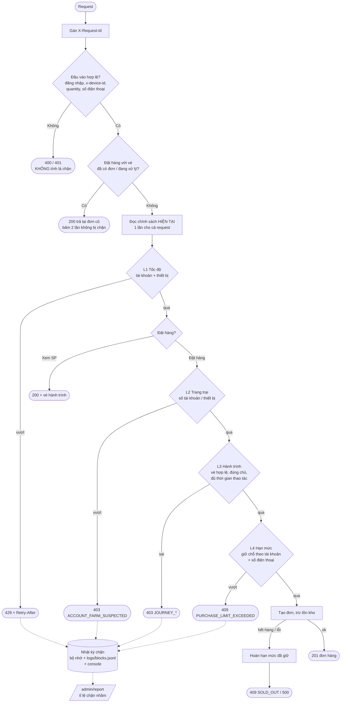

# Bài 9 – Lá chắn chống lạm dụng cho ngày hội mua sắm 11/11

> *"Ngày 11/11 năm ngoái, 40% đơn flash sale rơi vào tay bot. Khách thật thì không mua được, còn hệ thống thì sập 20 phút."*

**Kết quả demo** (`npm run demo`, kiểm chứng tự động trong [test/demo.e2e-spec.ts](test/demo.e2e-spec.ts)):

| Tiêu chí | Kết quả |
|---|---|
| Khách thật | 26 luồng, 91 request, **0 lần bị chặn**. Trong đó có gia đình dùng chung máy, khách bấm đặt hàng 2 lần, khách F5 liên tục, khách thao tác nhanh, và **tất cả dùng chung 1 IP** |
| Bot | Cả **4 loại** đều bị chặn bởi **đúng lớp** được thiết kế cho nó. Tỉ lệ sản phẩm rơi vào bot: **16,3%**, so với 40% năm ngoái |
| Bão F5 | Bot gửi 300 request thì 270 bị chặn ngay ở lớp 1, không chạm tới tồn kho hay đơn hàng |
| Đổi ngưỡng lúc chạy | `PATCH /admin/policy` có hiệu lực ngay ở request kế tiếp. Cùng `pid` và cùng thời điểm khởi động, tức là không khởi động lại |
| Truy vết | Mỗi lần chặn có `blockId` → biết lớp, quy tắc, ngưỡng, giá trị đo được, phiên bản chính sách, ai bị chặn, request nào |
| Tỉ lệ chặn nhầm | `GET /admin/report` → **0%** trên 286 lần chặn đã xem xét |

---

## 1. Bản đặc tả – thu hẹp yêu cầu mở

### 1.1 Định nghĩa lại vấn đề

Câu nói của CTO chứa **hai** vấn đề khác nhau:

1. **Bot lấy mất hàng** (40% đơn). Đây là vấn đề *công bằng*: hàng flash sale có hạn, mỗi đơn của bot là một khách thật không mua được.
2. **Hệ thống sập 20 phút.** Đây là vấn đề *tải*. Flash sale có lượng truy cập cao là chuyện tất nhiên, nhưng phần tải "vô ích" chủ yếu đến từ bot F5 liên tục để canh giờ mở bán.

Mục tiêu đo được:
- Tỉ lệ sản phẩm rơi vào bot giảm từ 40% xuống **dưới 20%**.
- Request rác bị chặn trước khi chạm tới tồn kho và cơ sở dữ liệu.
- **0** khách thật bị chặn oan trong kịch bản kiểm thử, và có cơ chế đo tỉ lệ chặn nhầm khi chạy thật.

### 1.2 Bốn kịch bản lạm dụng được chọn

| # | Kịch bản | Vì sao chọn | Dấu hiệu nhận biết |
|---|---|---|---|
| A | **Bot F5 liên tục** để canh giờ mở bán, rồi đặt hàng ngay khi mở | Nguyên nhân trực tiếp của sự cố **sập hệ thống**. Rẻ nhất để chặn | Số request / tài khoản và / thiết bị trong 10 giây vượt xa khả năng của tay người |
| B | **Trang trại tài khoản**: một máy chạy hàng chục tài khoản ảo | Cách phổ biến nhất để vượt quy định "mỗi tài khoản mua tối đa N cái". Đây là nguồn chính của con số 40% | Số tài khoản **khác nhau** đặt hàng từ cùng một thiết bị |
| C | **Gọi thẳng API**: script gửi `POST /orders` mà không đi qua trang sản phẩm, hoặc đặt ngay vài mili-giây sau khi mở trang | Bot chuyên nghiệp không render giao diện; chúng gửi request đặt hàng sớm hơn mọi khách thật | Thiếu **vé hành trình** do trang sản phẩm cấp, vé bị giả, hoặc thời gian từ lúc mở trang đến lúc đặt quá ngắn so với thao tác của người |
| D | **Gom hàng để bán lại**: nhiều tài khoản trên **nhiều máy khác nhau** (lách được kịch bản B), nhưng đều giao về một nơi | Kẻ gom hàng phải **nhận được hàng**. Địa chỉ hoặc số điện thoại nhận hàng là thứ họ không thể làm giả hàng loạt | Tổng số sản phẩm theo **số điện thoại nhận hàng**, đã chuẩn hoá `+84…` / `0…` |

**Những gì cố ý không làm, và lý do:**
- **Không chặn theo IP.** Cả văn phòng hoặc cả trạm 4G có thể ra Internet qua một IP (NAT, CGNAT). Chặn theo IP sẽ chặn oan cả một nhóm khách thật. Trong demo, mọi khách thật đều dùng chung một IP để chứng minh điều này.
- **Không chặn theo User-Agent.** Bot đổi được User-Agent chỉ bằng một dòng code. Trường này chỉ được ghi vào log để phục vụ điều tra.
- **Không dùng CAPTCHA, không phân tích hành vi chuột.** Cả hai cần phía client tham gia. Đây là hướng mở rộng tiếp theo (mục 6).

### 1.3 Nguyên tắc không chặn oan

1. **Chỉ chặn dựa trên dấu hiệu mà người thật gần như không thể tạo ra.** Ngưỡng mặc định để dư **khoảng 3 lần** so với hành vi người dùng ở mức cực đoan.
2. **Chặn mềm khi có thể.** Bị lớp 3 chặn vì thao tác quá nhanh thì chỉ cần bấm lại với cùng vé; mỗi phản hồi chặn đều có `blockId` và hướng dẫn khiếu nại.
3. **Bấm đặt hàng 2 lần không bao giờ bị chặn**, kể cả khi hai request tới gần như đồng thời. Request sau nhận lại đơn của request trước.
4. **Hết hàng không phải là "chặn".** Request trả `409 SOLD_OUT`, không ghi vào log chặn, và **hoàn lại** phần hạn mức đã giữ.
5. **Lá chắn hỏng thì cho qua (fail-open).** Kho bộ đếm lỗi thì lớp đó được bỏ qua và lỗi được ghi lại. Các lớp khác vẫn chạy độc lập.
6. **Shadow mode.** Bật một lớp hay một ngưỡng mới ở chế độ `shadow` trước: hệ thống chỉ ghi "lẽ ra đã chặn" để đo tỉ lệ chặn nhầm trên lưu lượng thật, sau đó mới chuyển sang `enforce`.

---

## 2. Kiến trúc

### 2.1 Luồng một request qua các lớp phòng thủ



Các lớp được xếp **từ rẻ đến đắt**:
1. Đếm (O(1)).
2. Tập phần tử khác nhau.
3. Kiểm chữ ký HMAC.
4. Giữ hạn mức (ghi dữ liệu).

Nhờ vậy, bão F5 bị chặn ở lớp rẻ nhất và không chạm tới tồn kho.

### 2.2 Bảng các lớp phòng thủ

| Lớp | Chặn hành vi | Áp dụng | Ngưỡng mặc định (đổi được lúc chạy) | Phản hồi khi chặn |
|---|---|---|---|---|
| **L1 Tốc độ** ([velocity.layer.ts](src/enforcement/layers/velocity.layer.ts)) | F5 liên tục, bấm đặt hàng liên tục (A) | Xem SP + đặt hàng | Mỗi tài khoản: xem **30** / 10 s, đặt **5** / 10 s. Mỗi thiết bị: xem 60 / 10 s, đặt 10 / 10 s | `429 VELOCITY_LIMIT` + `Retry-After` |
| **L2 Trang trại** ([account-farm.layer.ts](src/enforcement/layers/account-farm.layer.ts)) | Nhiều tài khoản trên một máy (B) | Đặt hàng | Tối đa **3** tài khoản khác nhau / thiết bị / 1 giờ. Tài khoản đã quen với máy này luôn được đặt tiếp | `403 ACCOUNT_FARM_SUSPECTED` |
| **L3 Hành trình** ([journey.layer.ts](src/enforcement/layers/journey.layer.ts)) | Gọi thẳng API, đặt hàng siêu tốc (C) | Đặt hàng | Bắt buộc có vé HMAC gắn với (tài khoản, thiết bị, sản phẩm). Từ lúc mở trang đến lúc đặt **≥ 800 ms**. Vé sống 10 phút | `403 JOURNEY_TOKEN_MISSING / _INVALID / _MISMATCH / _EXPIRED / JOURNEY_TOO_FAST` |
| **L4 Hạn mức** ([purchase-quota.layer.ts](src/enforcement/layers/purchase-quota.layer.ts)) | Gom hàng qua nhiều tài khoản, nhiều máy (D) | Đặt hàng | Mỗi tài khoản **2** cái / sản phẩm. Mỗi **số điện thoại nhận hàng** 2 cái / sản phẩm. Áp dụng trong 24 giờ | `409 PURCHASE_LIMIT_EXCEEDED` (kèm số còn được mua) |

Mọi phản hồi chặn đều có cấu trúc chung:
```json
{ "statusCode": 403, "code": "ACCOUNT_FARM_SUSPECTED", "message": "...", "blockId": "blk_…", "requestId": "req_…",
  "appeal": { "method": "POST", "path": "/api/appeals", "body": { "blockId": "blk_…" } } }
```
Thông báo trả cho client **không để lộ ngưỡng**, vì bot sẽ dựa vào đó để tinh chỉnh. Ngưỡng chỉ được ghi trong log nội bộ.

**Bốn lớp độc lập với nhau:** mỗi lớp có dữ liệu riêng (khoá `vel:*`, `farm:*`, `quota:*`, vé HMAC) và một chế độ riêng (`enforce` / `shadow` / `off`). Tắt hẳn một lớp thì các lớp khác vẫn hoạt động.

Lần chạy đầu tiên của demo có một trường hợp minh hoạ điều này. Kịch bản sinh nhầm số điện thoại trùng nhau giữa hai đợt bot trang trại. Lớp L4 bắt được đợt sau trước cả L2: một bot lách được lớp này vẫn bị lớp khác bắt.

### 2.3 Cơ sở chọn ngưỡng

| Ngưỡng | Hành vi người thật ở mức cực đoan | Bot | Ngưỡng |
|---|---|---|---|
| Xem sản phẩm / 10 s | F5 mỗi giây lúc 0h, tức 10 lần | Hàng trăm lần | 30 (dư 3 lần) |
| Thời gian thao tác | Mở trang → chọn số lượng → bấm → xác nhận: ≥ 1,2 s (khách nhanh nhất trong demo) | 0–50 ms | 800 ms |
| Tài khoản / thiết bị | Gia đình 2–3 người dùng chung máy | Hàng chục | 3 |
| Sản phẩm / số điện thoại | Một hộ gia đình | Gom hàng | 2 (theo quy định khuyến mãi) |

Trước 11/11, nên chạy toàn bộ ở chế độ `shadow` trên lưu lượng thật (hoặc phát lại log của năm ngoái), rồi chỉnh ngưỡng theo `GET /admin/report`.

### 2.4 Tổ chức mã nguồn (Clean Code)

```
src/
├── policy/          CHÍNH SÁCH – "chặn cái gì, ngưỡng bao nhiêu". Không có logic thực thi, không biết lưu trữ.
│   ├── policy.types.ts       kiểu dữ liệu, chế độ enforce / shadow / off
│   ├── default-policy.ts     ngưỡng mặc định kèm giả định
│   ├── policy.validator.ts   kiểm tra giá trị VÀ khoá lạ (gõ nhầm tên)
│   └── policy.store.ts       đổi lúc chạy, có phiên bản và lịch sử
├── storage/         LƯU TRỮ BỘ ĐẾM – chỉ biết "đếm", "tập", "tổng có trần". Không biết gì về bot.
│   ├── counter-store.ts      interface (đổi sang Redis: chỉ cần cài lại interface này)
│   └── in-memory-counter-store.ts
├── enforcement/     CƠ CHẾ THỰC THI – đọc chính sách, gọi lưu trữ qua interface. Không biết HTTP.
│   ├── defense-layer.ts      interface DefenseLayer, ShieldContext, verdict
│   ├── layers/               4 lớp, mỗi lớp 1 file
│   ├── journey-token.service.ts
│   └── shield.ts             chạy các lớp theo thứ tự, shadow, fail-open, hoàn hạn mức
├── observability/   QUAN SÁT – nhật ký chặn (bộ nhớ + JSON Lines + console), thống kê, tỉ lệ chặn nhầm
├── shop/            NGHIỆP VỤ – tồn kho, đơn hàng, chống tạo đơn trùng
├── http/            BỘ CHUYỂN ĐỔI HTTP – controller, interceptor, bộ lọc ngoại lệ. Chỉ dịch request ↔ ShieldContext
└── demo/            kịch bản demo
```

Hướng phụ thuộc chỉ đi một chiều: `http → enforcement → (policy, storage interface)`. Các lớp phòng thủ nhận `policy` làm tham số ở mỗi lần gọi, nên đổi ngưỡng không cần gửi thông báo hay khởi động lại.

---

## 3. Đo và báo cáo tỉ lệ chặn nhầm

Không có hệ thống nào **biết** chắc một request là khách thật hay bot. Vì vậy tỉ lệ chặn nhầm được đo qua ba nguồn:

| Nguồn | Cơ chế | Endpoint |
|---|---|---|
| **Xem xét** | Đội vận hành gắn nhãn từng lần chặn: `false-positive` (chặn nhầm) hoặc `confirmed-abuse` (đúng là lạm dụng) | `POST /admin/blocks/:id/verdict` |
| **Khiếu nại** | Khách dùng `blockId` trong phản hồi để khiếu nại. Mỗi khiếu nại là một tín hiệu "có thể chặn nhầm", chờ xem xét. Chỉ chủ tài khoản bị chặn mới khiếu nại được lần chặn đó | `POST /api/appeals` |
| **Shadow mode** | Đo số lần "lẽ ra đã chặn" của một ngưỡng mới **trước** khi bật thật | `PATCH /admin/policy` với `{ mode: 'shadow' }` |

Báo cáo `GET /admin/report` cho từng lớp và tổng:
- `evaluated`, `blocked`, `wouldBlock`, `errors`
- `reviewed { falsePositive, confirmedAbuse, unreviewed }`
- `appealsPending`
- `falsePositiveRatePct = chặn nhầm / (chặn nhầm + đúng là lạm dụng)`

Trong demo, mọi lần chặn được gắn nhãn theo "sự thật" của kịch bản (biết rõ ai là bot). Kết quả: **0 / 286 = 0%**. Test [api.e2e-spec.ts](test/api.e2e-spec.ts) chứng minh công thức tính đúng với dữ liệu có chặn nhầm: 1 chặn nhầm trên 2 lần chặn cho ra 50%.

## 4. Nhật ký chặn – truy vết một lần chặn

Mỗi lần chặn được ghi vào ba nơi:
1. **Bộ nhớ**: truy vấn qua `GET /admin/blocks?layer=&accountId=&deviceId=&code=`.
2. **File JSON Lines** `logs/blocks.jsonl`, một dòng mỗi lần chặn, sẵn sàng đẩy sang ELK hoặc Loki.
3. **Một dòng tóm tắt trên console.**

Ví dụ thật từ demo, lấy bằng `GET /admin/blocks/blk_mveqg1dn_bf20c1`:

```json
{
  "blockId": "blk_mveqg1dn_bf20c1",
  "at": "2026-10-19T04:06:47.291Z",
  "requestId": "req_b9fb63a96b93",
  "layer": "accountFarm",
  "rule": "maxAccountsPerDevice",
  "code": "ACCOUNT_FARM_SUSPECTED",
  "action": "blocked",
  "mode": "enforce",
  "status": 403,
  "threshold": { "maxAccountsPerDevice": 2, "windowMs": 3600000 },
  "observed": { "accountsOnDevice": 3 },
  "policyVersion": 2,
  "subject": { "accountId": "farmC-3", "deviceId": "dev-bot-farm-C", "ip": "::1", "productId": "iphone-17-flash", "quantity": 2, "phoneHash": "e143f83b83f0d188" },
  "request": { "method": "POST", "path": "/api/flash-sales/iphone-17-flash/orders", "userAgent": "python-requests/2.32" },
  "policyAtBlock": { "mode": "enforce", "maxAccountsPerDevice": 2, "windowMs": 3600000 }
}
```

Bản ghi này trả lời được các câu hỏi của đội vận hành:

| Câu hỏi | Trường |
|---|---|
| Ai bị chặn? | `subject` |
| Lớp nào, quy tắc nào? | `layer`, `rule` |
| Ngưỡng bao nhiêu, đo được bao nhiêu? | `threshold`, `observed` |
| Theo phiên bản chính sách nào? | `policyVersion`, `policyAtBlock` |
| Tìm log ở các hệ thống khác bằng gì? | `requestId` (cũng có trong header `X-Request-Id`) |

Số điện thoại chỉ được lưu dạng **băm** (`phoneHash`): đủ để liên kết các đơn với nhau, nhưng không lộ dữ liệu cá nhân trong log.

## 5. Chạy demo, test, server

```bash
npm install
npm run demo        # khởi động server trong tiến trình và chạy toàn bộ kịch bản (~20 s), in báo cáo
npm test            # 57 test, gồm cả chạy trọn kịch bản demo
npm run start:dev   # server tại http://localhost:3000 để test bằng Postman
BASE_URL=http://localhost:3000 npm run demo   # chạy demo vào server đang chạy
```

| Kịch bản demo | Lớp chặn | Kết quả |
|---|---|---|
| Bot 1: 300 lần F5 | L1 | 270 lần bị chặn |
| Bot 2: 8 tài khoản / 1 máy | L2 | Tài khoản 4–8 bị chặn |
| Bot 3: gọi thẳng API (không vé, vé giả, đặt sau 30 ms) | L3 | 6 / 6 bị chặn |
| Bot 4: 5 tài khoản, 5 máy, 1 số điện thoại | L4 | Tài khoản 2–5 bị chặn |
| 26 luồng khách thật | – | **0** lần bị chặn, 3 lần bấm đặt hàng 2 lần đều nhận lại đơn cũ |
| Đổi ngưỡng lúc chạy | L2: 3 → 2 | Đợt B (trước khi đổi) lọt hết. Đợt C (sau khi đổi) bị chặn tài khoản thứ 3, log ghi `policyVersion: 2` |
| PATCH sai tên khoá | – | 400, chính sách giữ nguyên |
| Dữ liệu rác (JSON hỏng, quantity sai, không đăng nhập, route lạ) | – | 4xx có cấu trúc. Request ngay sau đó vẫn 200 |

API quản trị (header `x-admin-token: admin-secret`):

| Method | Đường dẫn | Tác dụng |
|---|---|---|
| `GET` | `/admin/policy` | Chính sách hiện tại, phiên bản, `pid`, thời điểm khởi động |
| `PATCH` | `/admin/policy` (body `{ "patch": {...}, "reason": "..." }`) | Đổi ngưỡng lúc đang chạy |
| `GET` | `/admin/policy/history` | Lịch sử các phiên bản chính sách |
| `GET` | `/admin/blocks` (lọc theo `layer`, `accountId`, `deviceId`, `code`, `action`) | Danh sách lần chặn |
| `GET` | `/admin/blocks/:id` | Chi tiết một lần chặn |
| `POST` | `/admin/blocks/:id/verdict` | Gắn nhãn chặn nhầm / đúng là lạm dụng |
| `GET` | `/admin/report` | Báo cáo tỉ lệ chặn nhầm |
| `POST` | `/admin/reset` | Xoá bộ đếm và log, khôi phục chính sách mặc định |

Bộ test đã được kiểm chứng bằng cách cố ý gỡ các cơ chế chống chặn oan, và mỗi lần gỡ đều có test báo lỗi:
- **Gỡ cơ chế chờ request đang xử lý cùng vé:** khách bấm đặt hàng 2 lần bị lớp hạn mức chặn.
- **Đổi fail-open thành fail-closed:** khi kho bộ đếm lỗi, khách thật bị chặn.

## 6. Giới hạn và hướng mở rộng

- **Mã thiết bị (`x-device-id`) do SDK phía client gửi, nên bot có thể làm giả.** Bot đổi mã thiết bị cho từng tài khoản sẽ lách được L2. Khi đó vẫn còn L3 (vẫn phải đi qua trang sản phẩm và chờ đủ thời gian) và L4 (vẫn phải giao hàng về một nơi). Đây chính là lý do cần nhiều lớp. Có thể tăng cường bằng dấu vân tay thiết bị phía server, hoặc device attestation (Play Integrity / App Attest).
- **Chạy nhiều instance:** cài `CounterStore` bằng Redis, mỗi thao tác là một Lua script nguyên tử (xem Bài 8). Chính sách lưu ở Redis hoặc etcd và phát sự kiện khi thay đổi.
- **Phòng chờ ảo** cho lúc 0h: xếp hàng có thứ tự thay vì để mọi người cùng F5, giúp giảm tải ngay từ gốc.
- **CAPTCHA làm phản hồi bậc giữa** cho L2 / L3: thay vì chặn hẳn, yêu cầu xác minh. Khách thật qua được, bot thì không.
